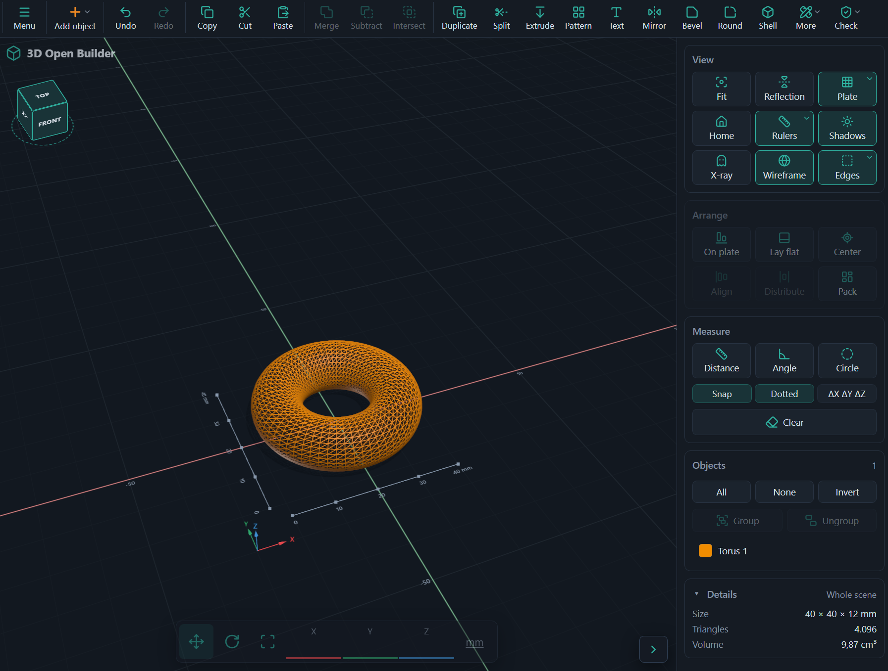

# 3D Open Builder

A free, open-source 3D model builder for 3D printing that runs entirely in your browser. Your files never leave your computer.

- **Shapes and threads:** basic shapes, plus bolts, nuts, threaded rods and threaded holes in metric and imperial sizes.
- **Combine and edit:** merge, subtract, intersect, split, mirror, pattern, extrude down to the plate, shell, edge bevel and rounding, braces, and raised or cut-in text (also on curved faces).
- **Place precisely:** move, rotate and size handles with snapping, align and distribute, lay flat, measuring tools, and a reference picture to trace over.
- **Print-ready:** print check with automatic repair, best print orientation, and export to 3MF (with colours) or STL. Imports 3MF, STL and OBJ.
- **Safe to use:** 100 undo steps, autosave, and works on desktop, tablet and phone.

**Use it:** https://covrig.github.io/3d-open-builder/

## Run it locally

Requires Node.js 26 or newer.

```bash
npm install
npm run dev      # http://localhost:5173
```

`npm test` runs the unit tests, `npm run check:browsers` runs automated checks
in the installed Chrome, Edge and Firefox, and `npm run build` creates the site
in `dist/`. Every push to `main` is tested and published to GitHub Pages.

## What's where

| Path | Contents |
|---|---|
| `index.html` | The app page: toolbar, sidebar, dialogs. |
| `privacy.html` | The privacy statement page. |
| `src/` | The app's source code (TypeScript): |
| `src/main.ts` | Starts the app and connects the toolbar and sidebar to the features. |
| `src/geometry/` | Pure geometry, no user interface: shapes, Merge/Subtract/Intersect, split, extrude, edge bevel and rounding (chamfer, fillet), brace, shell, threads, text, mesh check and repair. `worker.ts` runs the heavy operations in the background so the page stays responsive. |
| `src/scene/` | The 3D view: camera, ground grid, rulers, move/rotate/size handles, and the list of objects with undo/redo. |
| `src/ui/` | Toolbar menus, sidebar panels, tooltips and the tools that take clicks in the view (measuring, picking edges, reference picture). |
| `src/io/` | Reading and writing 3MF, STL and OBJ files. |
| `src/app/` | Autosave, restore and error recovery. |
| `src/style.css` | The look of the app, in light and dark colours. |
| `docs/` | The screenshot at the top of this page. |
| `public/` | Files served as they are: the app icon, fonts for text on faces, and the licence texts of the libraries used. |
| `tests/` | Unit tests for the geometry, file formats and saving. |
| `vendor/` | The libraries the app uses, stored in this repository so nothing is fetched from other sites — see `vendor/README.md`. They are: **three** (3D drawing), **manifold-3d** (solid geometry engine), **fflate** (zip, for 3MF files), **lucide** (icons) and **opentype.js** (reading fonts). |
| `scripts/` | Helper scripts for developers: listing library licences, cross-browser checks. |
| `.github/workflows/` | Builds, tests and publishes the site on every push. |
| `package.json` | Project settings and the commands above; `package-lock.json` pins exact versions. |
| `vite.config.ts`, `tsconfig.json` | Build and TypeScript settings. |

## Licence

MIT — see [LICENSE](LICENSE). Bundled libraries and fonts keep their own
licences (listed in the app under File → About and libraries).
